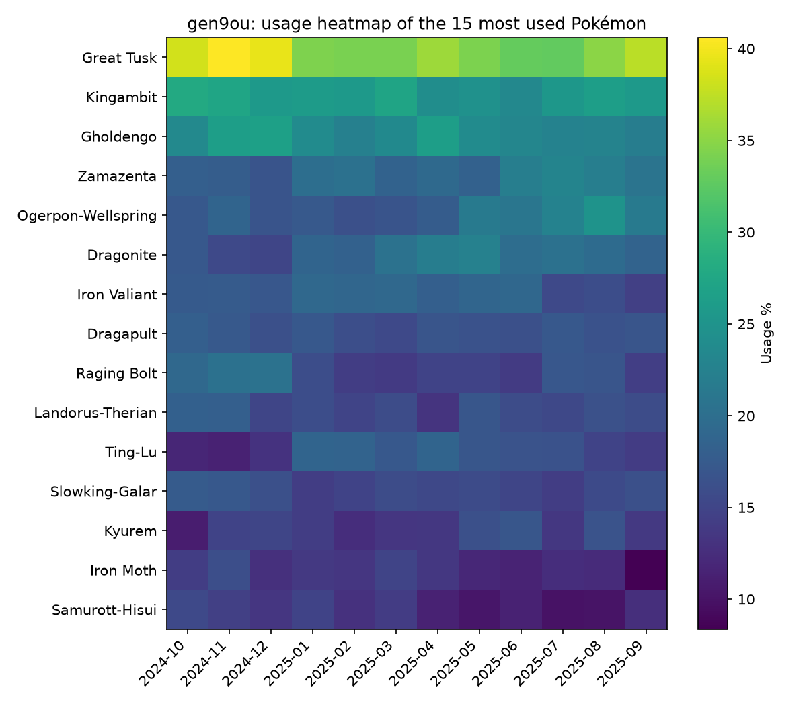
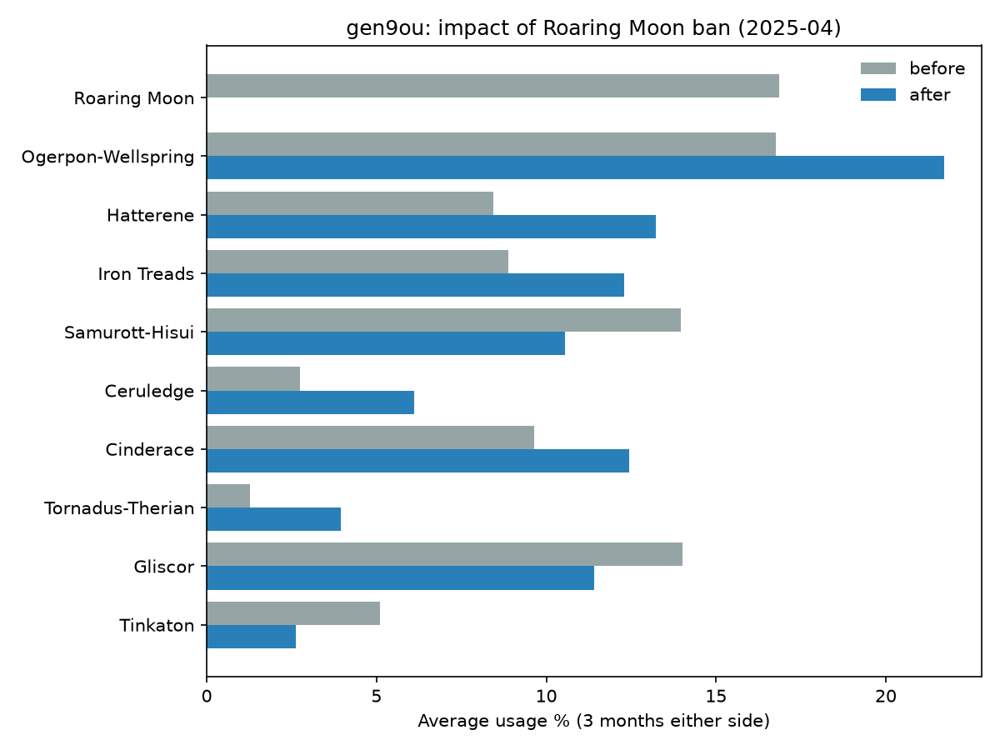
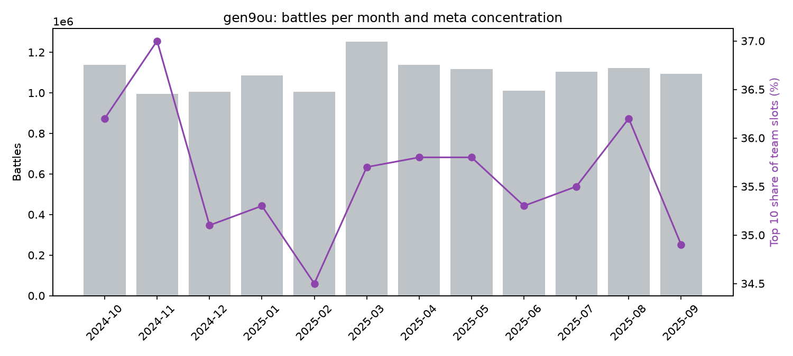
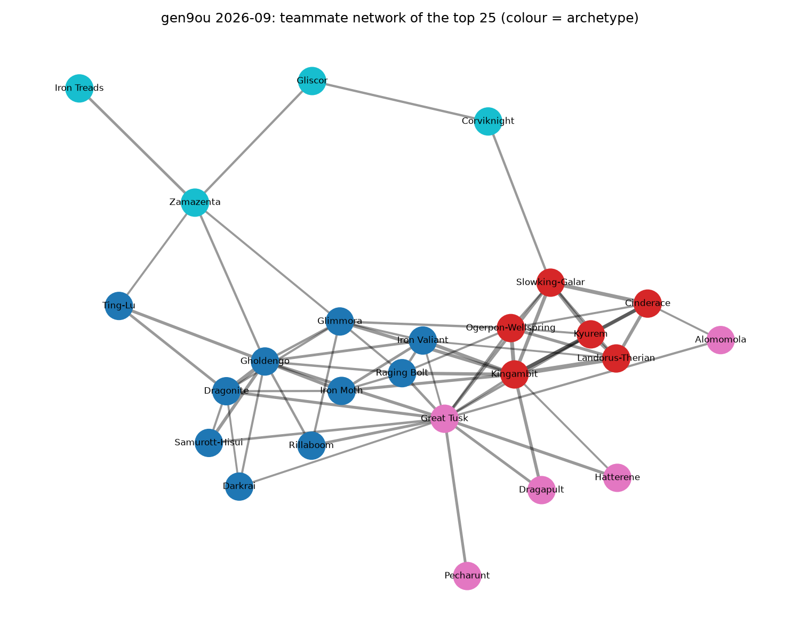

# Pokémon Competitive Meta Tracker

A data pipeline that collects [Smogon's monthly usage stats](https://www.smogon.com/stats/) and explains
**how the competitive meta changes over time, and why**. It's an analysis product, not a stats viewer.

Most sites (including Smogon's own pages) show one month at a time. This project focuses on change:

- **Trend history**: usage of any Pokémon across months or years
- **Event impact analysis**: usage before vs after a ban, DLC release or suspect test
- **Teammate network graph**: which Pokémon cluster into archetypes
- **Written insight reports**: a monthly "what changed and why" report

> **Live dashboard: [Open the Meta Tracker](https://pokemon-meta-tracker-lvxim6hx4xmcluqcqqmvst.streamlit.app)**
>
> Used by the [Pokémon Team Builder](https://pokemon-team-builder-lemon.vercel.app), which suggests teammates from this project's data.

## Findings

Gen 9 OU, October 2024 to September 2026: **24.2 million battles** at the 1695 rating cutoff. Event dates come
from [Smogon's tiering history](https://www.smogon.com/forums/threads/sv-ou-forum-rules-ou-council-info-and-announcements.3710769/).

**1. The top of the meta barely moves.** Great Tusk was #1 in all 24 months (30.6% to 40.6% usage), and
Great Tusk, Kingambit and Gholdengo were the top three in 20 of them. The top 10 never changed by more than
two Pokémon in a month, and together they held 32.7% to 37.4% of all team slots.



**2. The biggest change was a ban.** Roaring Moon went from #4 (21.1%) in March 2025 to #114 (0.4%) in April,
after voters banned it on 1 April (66.07%, 74 to 38). That's the sharpest monthly move in the dataset. Its
usage had actually jumped 5.7 points in March, the month the suspect test was announced.

**3. Usage shifted to several Pokémon, not one replacement.** Comparing the three months either side of the
ban (January to March vs May to July 2025), nobody took Roaring Moon's whole share. Ogerpon-Wellspring gained
5.0 points, Hatterene 4.8, Iron Treads 3.4 and Ceruledge 3.4, while Samurott-Hisui lost 3.4. This shows
timing, not proof that the ban caused each change.



**4. Retests create a one-month spike.** Palafin was only legal during its retest from 20 December 2024, yet it
reached #14 (13.5%) that month, then 2.5% in January after voters kept it banned on 4 January. Volcarona did
the same in May 2026: #23 (9.2%), then gone in June after it stayed banned on 16 May. Both are reminders that
a sudden spike can come from a test rather than a real trend. The months around Palafin's retest also saw lasting
shifts (Pecharunt +6.9 points, Ting-Lu +6.5, Great Tusk −5.3 comparing October to November with January to
March), which the retest alone doesn't explain.

**5. An unban isn't always a comeback.** Regieleki was unbanned on 26 April 2026 after the Tera Blast ban. It
peaked at just 2.2% (#61) in May and was at 0.8% by September, so it never became a regular pick.

**6. The Tera Blast ban lines up with a change at #2.** Gholdengo overtook Kingambit from April to July 2026,
averaging 27.0% in the three months after the ban against 22.3% in the three before. Its rise began in April
though, before the ban on the 26th, so the ban can't take all the credit. Kingambit returned to #2 in August
and hit its two-year high of 30.7% in September.

**7. The slowest changes can be the biggest.** Cresselia was the biggest two-year riser, from 0.6% to 7.8%,
with nearly all of that since June 2026. Ceruledge went from 1.8% to 8.0%, Kyurem from 11.0% to 17.0% and
Glimmora from 9.2% to 15.1%. Dragapult fell from 18.1% to a two-year low of 10.4%.

**8. Fewer battles are being played.** Monthly battles fell 55% from 1.29 million in March 2026 to 574,541 in
September 2026, the lowest in the dataset. The stats can't say why, but recent months rest on smaller samples.



**9. The meta forms clear team styles.** Clustering who gets paired with whom gives four groups in September
2026. Pairings can be very strong: Landorus-Therian appears with Kingambit on 60.3% of its teams, and Dragonite
with Gholdengo on 53.1%.



## How it works

```
smogon.com/stats ──fetch.py──▶ data/raw/ ──parse.py──▶ DataFrames ──db.py──▶ data/meta.db (SQLite)
                                                                                  │
                     analysis.py / queries.sql ◀──────────────────────────────────┘
                              │
          ┌───────────────────┼─────────────────────┐
     report.py (Markdown)  charts.py (PNG)   dashboard/app.py (Streamlit)
```

| Module | Role |
| --- | --- |
| `fetch.py` | Downloads the usage `.txt` and `chaos` JSON files for each month (cached, chaos gzipped) |
| `parse.py` | Regex parser for the usage table; extracts teammates, moves and items from chaos JSON |
| `db.py` | SQLite schema (`pokemon`, `format_months`, `usage`, `teammates`, `moves`, `items`, `events`) |
| `queries.sql` | 11 named SQL queries answering real questions (window functions, CTEs) |
| `analysis.py` | Risers/fallers, before/after event impact, teammate graph and archetype clustering |
| `report.py` | Monthly "what changed and why" Markdown report |
| `charts.py` | Six matplotlib charts for the README and reports |
| `names.py` | Turns ids like `heavydutyboots` into Heavy-Duty Boots, using Pokémon Showdown's data |
| `export.py` | JSON export (usage, history, teammates, items, moves) consumed by the JavaScript Team Builder |
| `pipeline.py` | Fetch, then parse, then load; `update` picks up newly published months |

## Quick start

```bash
python -m venv .venv
.venv\Scripts\activate            # macOS/Linux: source .venv/bin/activate
pip install -e ".[dashboard,dev]"

meta-tracker ingest --start 2024-10 --end 2026-09   # 24 months of gen9ou (cutoff 1695)
meta-tracker status
meta-tracker query                                  # list the SQL queries
meta-tracker query biggest_risers --month 2026-09
meta-tracker query pokemon_trend --pokemon "Kingambit"
meta-tracker report                                 # reports/gen9ou-<latest>.md
meta-tracker charts                                 # reports/figures/*.png
meta-tracker export                                 # exports/meta-gen9ou.json for the Team Builder
streamlit run dashboard/app.py
```

Other formats: `meta-tracker --format gen9uu --cutoff 1630 ingest --start 2025-01 --end 2026-09`.
OU uses cutoffs 0/1500/1695/1825; lower tiers use 0/1500/1630/1760.

## The SQL questions

| Query | Question |
| --- | --- |
| `top_usage` | What were the most used Pokémon this month? |
| `pokemon_trend` | How has one Pokémon's usage changed month by month? |
| `biggest_risers` | Which Pokémon gained the most usage since the previous month? |
| `biggest_fallers` | Which Pokémon lost the most usage since the previous month? |
| `new_to_top_30` | Who broke into the top 30 this month? |
| `most_consistent` | Which Pokémon stayed in the top 20 for the most months? |
| `most_volatile` | Whose usage swings the most? |
| `top_teammates` | Who does this Pokémon get paired with most often? |
| `top_items_and_moves` | What items and moves does this Pokémon run? |
| `activity` | How many battles were played each month, and how concentrated was the meta? |
| `peak_months` | When was each top Pokémon at its peak? |

## Events (bans, DLC, suspect tests)

Edit [`data/events.csv`](data/events.csv) and run `meta-tracker events`. The before/after analysis
compares the N months before the event with the N months after it, **excluding the event month itself**,
because bans and releases rarely land on the 1st. Ingest months on both sides of an event to analyse it
(e.g. `--start 2023-06 --end 2024-03` for the two Scarlet/Violet DLCs).

## Automation

- `.github/workflows/update-data.yml` runs on the 3rd of each month. It fetches newly published
  months, regenerates the report and charts, and commits `data/meta.db`.
- `.github/workflows/tests.yml` runs the test suite on every push.

## Deploying the dashboard

1. Commit `data/meta.db` (raw downloads in `data/raw/` are git-ignored).
2. On [share.streamlit.io](https://share.streamlit.io), create an app from this repo with
   main file `dashboard/app.py`. It installs `requirements.txt` automatically.

## Roadmap

- [x] Parser, SQLite schema, loader
- [x] 10+ SQL queries
- [x] Risers/fallers, event impact, teammate network
- [x] Monthly report and charts
- [x] Streamlit dashboard
- [x] GitHub Action for new months
- [ ] Stretch: usage forecasting (e.g. ARIMA / gradient boosting on monthly usage)
- [ ] Stretch: archetype clustering on full team compositions
- [x] JSON export for the JavaScript Team Builder project

## Testing

```bash
pytest -q
```

Tests use small synthetic files in Smogon's real formats, so they need no network access.

Data © Smogon University. This is an unofficial fan project.
